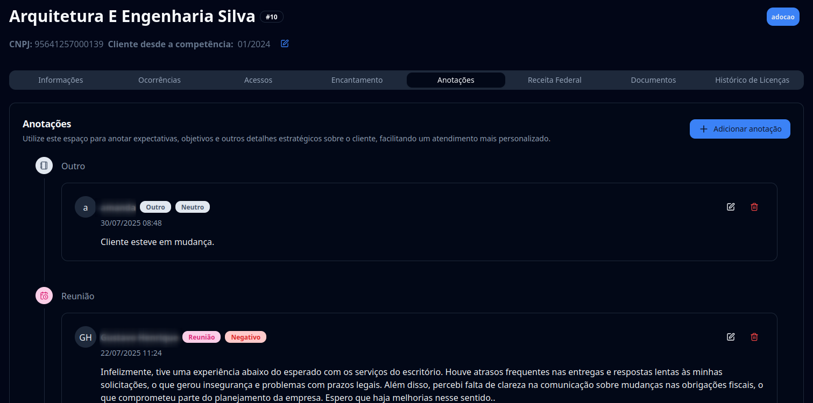

## Introdução

Bem-vindo ao tutorial do **G Client**!  
Neste guia, você aprenderá como adicionar anotações nos perfis dos seus clientes.

## Passo a passo para adicionar anotações

### 1. Acesse o G Client

Faça login na sua conta do **G Client**.

### 2. Navegue até a seção **Gestão de Clientes**

No menu lateral, clique em **Clientes**.  
Você verá a listagem de todos os clientes. Escolha aquele em que deseja adicionar a anotação.

### 3. Acesse a aba **Anotações**

Na parte superior da página do cliente, clique na aba **Anotações**.

Clique no botão **+ Adicionar anotações** para abrir o formulário.  
Preencha os campos obrigatórios:

- **Tipo de anotação**: Expectativa, Objetivo, Observação, Reunião, Feedback ou Outro.
- **Impacto**: Positivo, Negativo ou Neutro.
- **Descrição**: detalhe da anotação.

Depois, basta salvar.

---

✅ **Pronto!** Agora você sabe como adicionar anotações nos clientes dentro do **G Client**.  
Se precisar de ajuda, entre em contato clicando [aqui](https://api.whatsapp.com/send?phone=5544997046569&text=Preciso%20de%20ajuda%20sobre%20um%20tutorial)!

🎉 **Obrigado por usar o G Client!**
